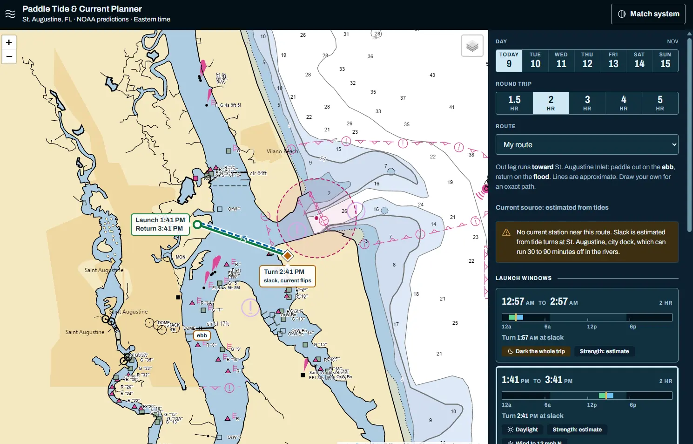

# Paddle Tide & Current Planner

Pick a launch time so your paddle rides the tail of one current out and the start of the next one back, with the turnaround at slack water.

**Live site: https://chrislanejones.github.io/paddle-planner/**



It's built for kayakers and stand-up paddleboarders around St. Augustine, Florida. A tide table gives you times. This gives you the whole out-and-back trip and where it sits in the day: when to launch, when to turn, when to be back, whether it's daylight, and how hard the wind is blowing.

Mirrors: [GitHub](https://github.com/chrislanejones/paddle-planner) and [Codeberg](https://codeberg.org/chrislanejones/paddle-planner).

## What you get

- **Launch windows.** Pick a day and a round-trip length (1.5 to 5 hours). Each window shows launch, turn and return, with the turn centered on slack water.
- **The slack band.** Every window is drawn on a 24-hour strip: green for the way out, blue for the way back, amber at the turn, with daylight behind it. The same colors show up on the chart and the map.
- **The tide and current chart.** Drag across it to scrub through the day. The readout under it tells you the current, the tide height and the wind at that minute, and which leg the current is helping.
- **The map.** NOAA's nautical chart by default, with your route drawn on top and the inlet hazard marked where it is. Switch to OpenStreetMap or ArcGIS if you want.
- **Eleven preset routes and one of your own.** From Guana down to Palm Coast, including the San Sebastian River, Moultrie Creek, Pellicer Creek, Anastasia Island and Summer Haven. Draw a custom route on the map and it's saved in your browser.
- **Daylight and wind per window.** Windows that start or end in the dark say so.
- **Light and dark themes.** It follows your system, or you can pick one. Contrast is checked by a test, because glare at a boat ramp is real.

## Run it

You need Node 22.12 or newer and pnpm.

```sh
pnpm install
pnpm dev
```

Then open the address Vite prints. Other scripts:

| Command | What it does |
|---|---|
| `pnpm dev` | Dev server on all interfaces, so you can test on your phone |
| `pnpm build` | Production build into `dist/` |
| `pnpm preview` | Serve the production build |
| `pnpm lint` | ESLint |
| `pnpm test` | Unit tests (`node --test`) |

## Where the data comes from

| Data | Source |
|---|---|
| Tide heights and times | NOAA CO-OPS predictions |
| Currents and slack water | NOAA CO-OPS current predictions, nearest station to the route |
| Hourly wind | National Weather Service forecast |
| Chart tiles | NOAA Office of Coast Survey nautical chart |

There's no backend and no accounts. The browser talks straight to those services. If no current station is close enough, the app falls back to estimating slack from tide turns and says so on the page, because those estimates can run 30 to 90 minutes off in the rivers.

## How far ahead can you trust it

- **Tides and currents:** predictions come from harmonic math, so they hold up the full week. Wind, river runoff and storm surge can still move them.
- **Wind:** the NWS hourly forecast is solid for two or three days and gets softer after that. Treat day six wind as a hint.

## Good to know

- All times are Eastern.
- The NOAA chart service sometimes answers with an error page instead of a tile. The map retries failed tiles with a short backoff, so a blank square should fill in on its own.
- The optional ArcGIS key is stored in your browser only. The only place it's sent is ArcGIS, to load its map tiles.
- **Not for navigation.** Check the marine forecast, wear a PFD, and tell someone your float plan.

## Under the hood

React 19, Vite, Leaflet, plain CSS with design tokens, Phosphor icons, and self-hosted Archivo. The code is split like this:

- `src/lib/planner.js` has the window math: finding slack turns, scoring daylight and wind, Eastern-time handling that survives DST.
- `src/lib/api.js` fetches and caches the NOAA and NWS data.
- `src/lib/routes.js` holds the preset routes, tide stations and inlet positions.
- `src/components/` has the map, chart, windows list and readout.
- `src/tokens.css` is the design system. `DESIGN.md` explains it and `PRODUCT.md` says who it's for.
- `paddle-planner.html` is the original single-file version, kept as a reference.

## Deploys

Every push to `main` runs lint, tests and a build in GitHub Actions, then publishes to GitHub Pages. The workflow is in `.github/workflows/pages.yml`.
